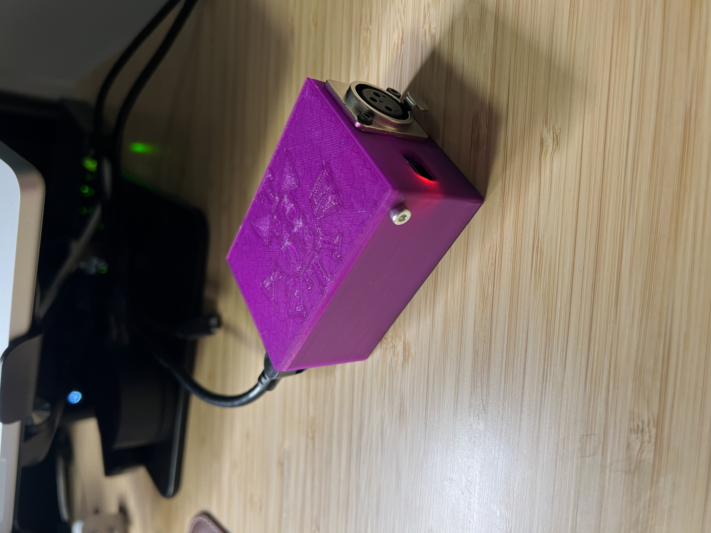
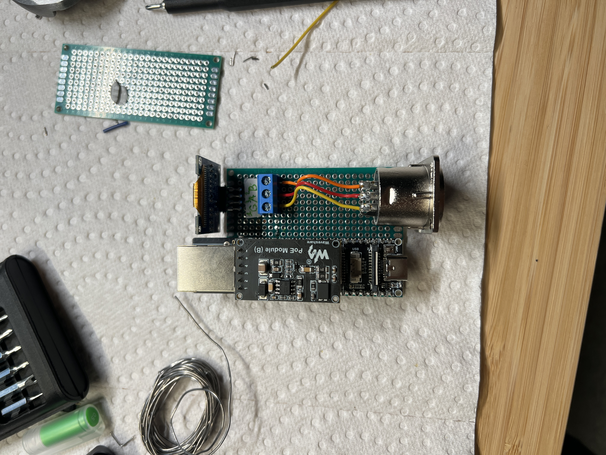
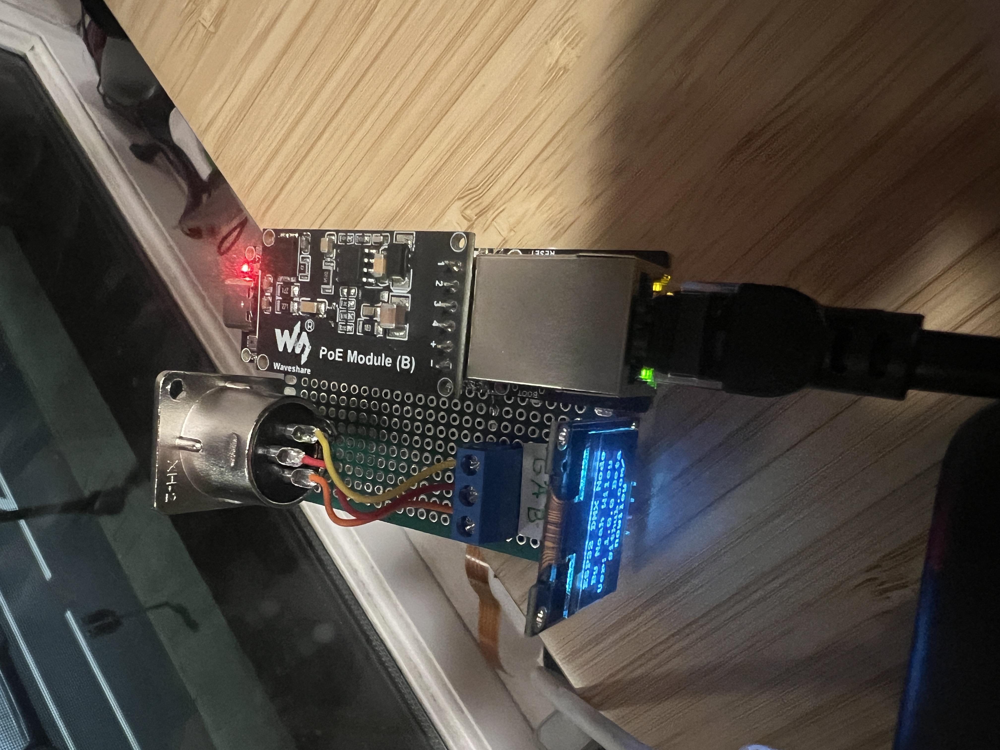
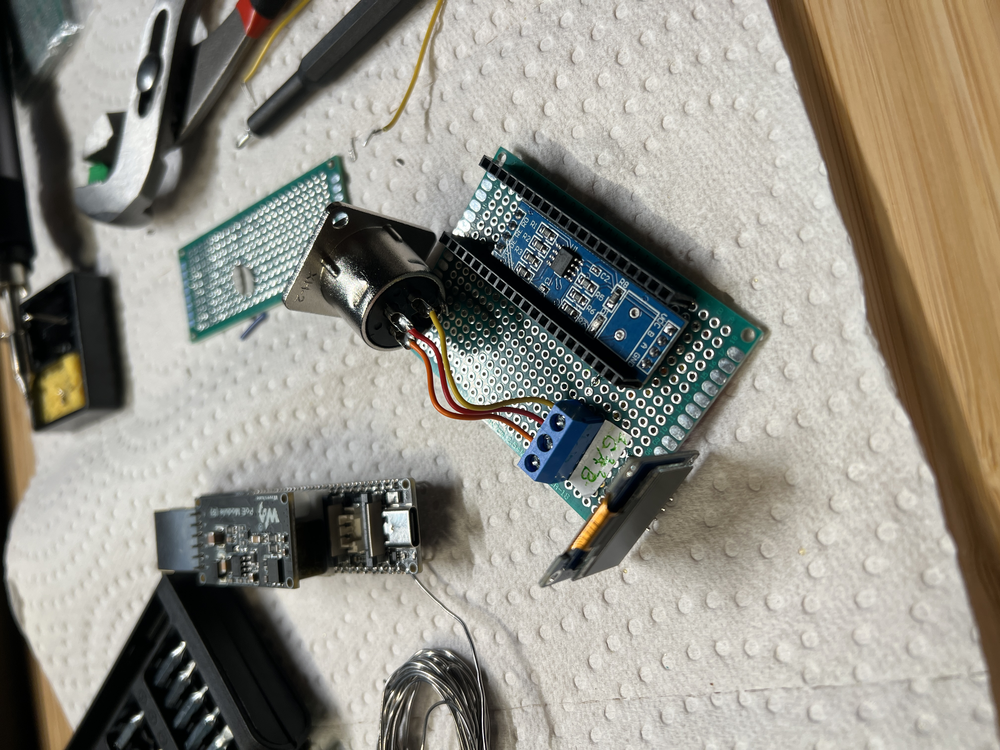

# Ethernet Artnet to DMX Node
Low-latency Artnet to DMX decoder with off the shelf parts. Utilizing both cores of ESP32-P4, MAX485 chip, SSD1306, and POE. Features custom protoboard layout, enclosure, physical display, mDNS, and web interface configuration. Processed hundreds of millions of packets with no failures.

### Details
- Role: Personal Project
- Dates: January 2026
- Vision: Create simple yet robust and performant solution and completely eliminate previous issues

### Goals 
- Eliminate 100% of jitter and connection instability caused by WiFi
- Increase responsiveness and performance of the system while providing simple user interface
- Low cost, easy to manufacture, and quick to production

## Gallery

    
    
    
    
    
    
    
    
    

 

## Observations and Motivation
**WiFi Issues:** 

## Design and Process
**First Steps:** Identify needs of project like environment, interface, manufacturing process, and precice measurements. Sketch out ideas on paper, create initial design in Fusion 360, and produce a low fidelity prototype with 3D printer or CNC machine. Test fit, function, and aesthetics before iterating on design. 

**Assembly and Finishing:** Often times use PLA for prototypes and ABS for final parts. Use heat, acetone, and sanding to smooth out rough edges and improve final product. For high strength parts, use high strength epoxies and metal inserts to increase strength and durability.

**MIDI Launchpad Enclosure:** Designed to fit a matrix of arcade buttons and an Arduino Nano. Added reinforcements under buttons to stand up to heavy use during performances. Carefully added mounting points to position USB port of Arduino Nano to allow for easy use.

**Frame with Rigid Camera Mount:** Designed to interface with existing lower frame for [low power robotic car](/project_pages/low_power_perception.html). Camera mount is rigid to allow robust IMU-Camera calibration for SLAM. Quickly printable and easy to assemble with melt in pins not requiring screws.

**Basement Design:** Custom stage and DJ booth for a complex basement geometry. Designed to fit closely to existing walls and support heavy loads. Also factored in common building materials and construction techniques to make the design easy to build.

**Lighting Corner:** Designed to fit acrylic diffuser tubes (repurposed fluorescent light guards) and custom control control circuits. Symmetric design allows for easy printing and assembly. Designed to be mounted on celings while providing a sleek look for [custom lights](/project_pages/club_lighting.html). 

**Personal AC Unit:** To combat a hot summer in San Francisco, designed a custom AC unit using 12v computer fans, copper tubing, and a 12v power supply. Enclosure includes a sponge/water resivoir to prevent condensation leaks. Enclosure is desinged in two parts for easy assembly and a sleek look.

**Wireless Charging Stand:** Designed in two pieces to allow for optimal print orientation, surface finish, and strength. Easily assembles without screws and fits common wireless charging coils.

**Boat Speaker Mount Adapter:** Designed to fit a custom speaker mount to a boat tower. Design includes slots for hose clamps to support the extra large speaker on a single mount. Laser cut from 3/8 inch steel and powder coated for durability.

**Electric Skateboard Wheel Pulley:** Modified from online STL to fit a custom wheel and skateboard truck with less clearance. Design incorporates nuts and bolts for a secure fit and durability on rough and rocky roads. Printed in ABS and is holding up in cooler scooter for over 3 years.

**Secure Bag Lock:** Custom made for a pattented security bag. Replaced prototype design made with epoxy putty. Designed to be durable, easy to manufacture, and easy to install. Product is used today in San Francisco to protect high value items in high theft areas.

