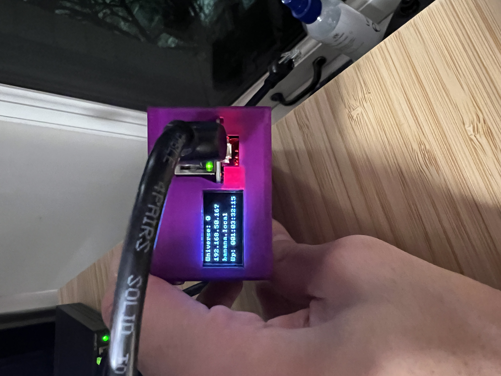
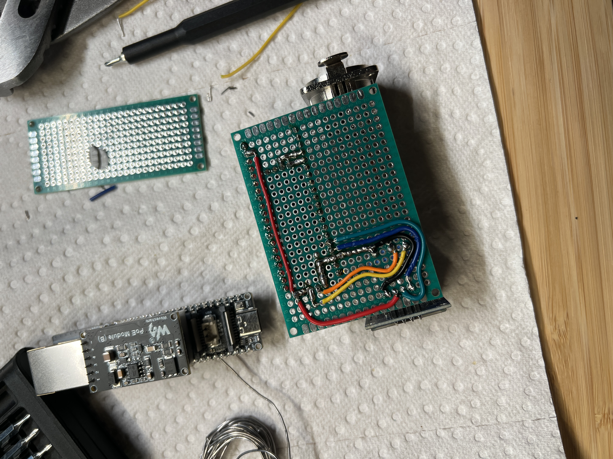
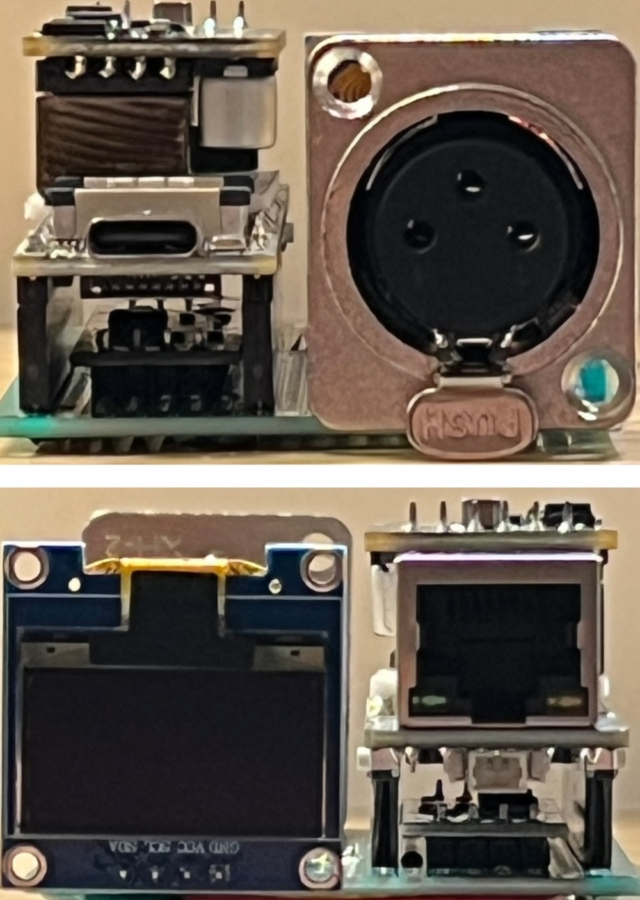
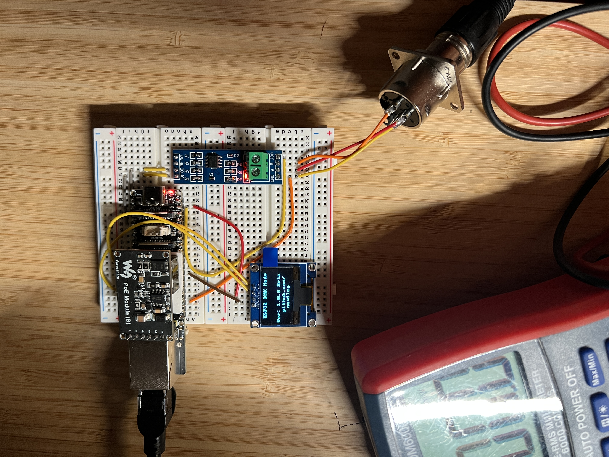
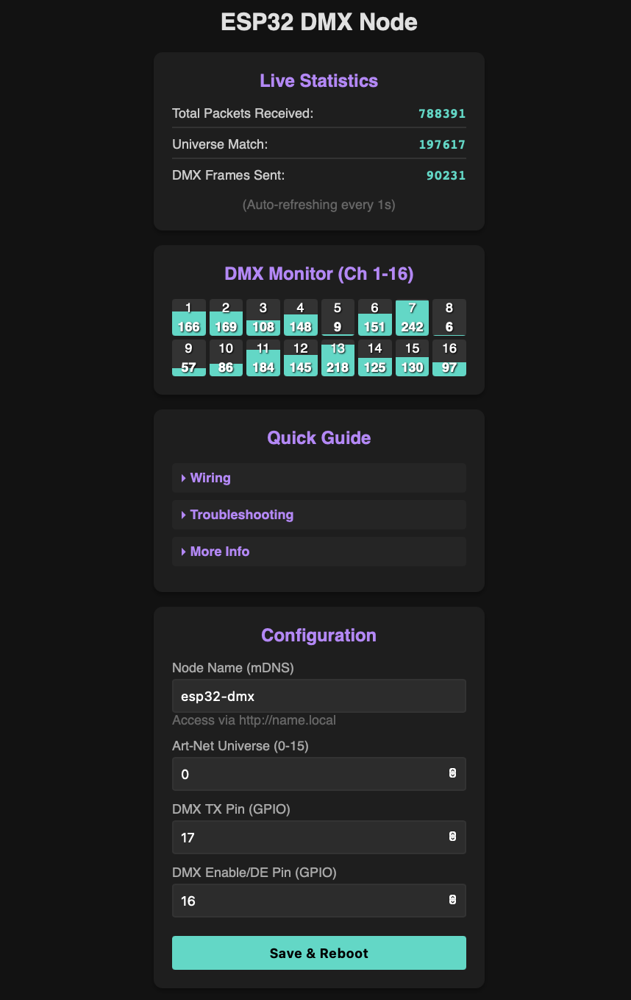

# Ethernet Artnet to DMX Node
Low-latency Artnet to DMX decoder with off the shelf parts. Utilizing both cores of ESP32-P4, MAX485 chip, SSD1306, and POE. Features custom protoboard layout, enclosure, physical display, mDNS, and web interface configuration. Processed hundreds of millions of packets with no failures.

### Details
- Role: Personal Project
- Dates: January 2026
- Vision: Create simple yet robust and performant solution and completely eliminate previous issues

### Goals 
- Eliminate 100% of jitter and connection instability caused by WiFi
- Increase responsiveness and performance of the system while providing simple user interface
- Low cost, easy to manufacture, and quick to production

## Gallery

    
    
    
    
    
    
    
    
    
    

 

## Background
**Related Work:** This project is a deep dive into a specific upgrade to the [club lighting setup](/project_pages/club_lighting.html). That page gives good detail about an overall system to controll lights. Here we will focus on controlling off the shelf lighting fixtures.

**Light Fixtures:** A quick search for "dj light fixtures" will show hundreds of makes and models. Each fixture usually has 10 to 50 channels which are 8-bit numbers (0-255) controlling current attributes like brightness, color, pattern, pan, tilt, strobe, speed, internal prism, etc. Changing a channel usually results in a nearly instantaneous change in the attribute. 

**Controlling the Lights:**  To keep the effects smooth, aim to update most channels 30-60 times a second. Concert venues can have thousands of fixtures, so thats a lot of bits per second (~8-20 MBit/s). Luckily, there is a protocol called Artnet to send this data over UDP. There are programs like QLC+ that output Artnet natively. That way all we do is use network architecture to distribute the information. GREAT! One problem; only expensive fixtures use this protocol. 

**Budget Lighting:** Professional fixtures are fun to look at but not fun to pay for. They can range from $1000 to $20,000 each (if you don't believe me [here is one](https://www.bhphotovideo.com/c/product/1935584-REG/etc_2581a1400_1b_end_systems_solahybeam_3000.html/specs)). On the other hand, there are so many feature rich light fixtures readily accessible on amazon, ebay, and aliexpress for ~$100 each. Only downside, they use the orignal lighting protocol called Digital Multiplex.

**Digital Multiplex:** or DMX512 provides 512 8-bit channels, uses differential signaling, and allows for daisy chaining. A device to convert from Artnet over UDP to DMX is all we need to leverage modern software and low-cost light fixtures.

## First Solution
**First Try:** Originally we utilized an ESP8266 WiFi Artnet to DMX node by <a href="https://robertoostenveld.nl/art-net-to-dmx512-with-esp8266/" target="_blank">Robert Oostenveld</a>. Big shoutout, his design works right out of the box and is probably what most people need.

**Observations:** The node worked as advertized, however the connection was finniky. The module needed to have line of sight to the router and had trouble automatically reconnecting. It worked when no one was in the basement, but when there was a party the connection would be extremely unstable.

**Diagnosis:** As you probably know, humans have always have their phones and are made of water. Water absorbs 2.4GHz pretty well and the 2.4GHz noise from those phones make it really hard for the 2.4GHz WiFi node connect. 

## This Design
**Component Selection:** My main considerations were for parts to be easily accessible, have ethernet onboard using the ESP32s MAC instead of externally using SPI, and USB programmability. Additionally, I wanted features like a display for easier debugging and power over ethernet to avoid a rat nest of wires. These are the parts I settled on.
1. [Waveshare ESP32-P4 with the POE module](https://www.amazon.com/ESP32-P4-Ethernet-Development-MIPI-CSI-Microphone/dp/B0FN7JQ2V8/ref=sr_1_4?crid=127OTR3IKUKUI&dib=eyJ2IjoiMSJ9.s4VET-pWFP4D4736mmyriiPU1IBXXAZumrqDuhpLKXH-34IJky2-ROPa8WaNHLmF2vrO-0azCmyfJQ0r_ZFvkshML-9By21tZnJTBA_bHPI9zF2zdxEu_ic9YNYpFN0ZXkhhoPPByUNADoI0F9jMgASzfoqbXRaN2f6jmWTt2MHO-k7OADaz2XrVYiO3t7yjp9aGvQQk9az4JwgMQOmrp-K1ilR7XN-KbMNGZ6N2flb_wQQfcGBw5VlNYwJLk-Z0dDddBWVoyePNslIFJFWfcnFcaP0pgkrkYIrrwrTSZc8.UphJv3My10dD9foPmf-J6UcGJhktTIaIc55dZcBtTNo&dib_tag=se&keywords=waveshare%2Bp4&qid=1794453794&sprefix=waveshare%2Bp4%2Caps%2C171&sr=8-4&th=1) 
2. [MAX485 TTL to Diff Pair Tranciever](https://www.amazon.com/DigiYes%C2%AE-Transceiver-Instrument-Development-Accessories/dp/B0BPSRF4J7/ref=sr_1_9?crid=3VOAGO2EF5LTB&dib=eyJ2IjoiMSJ9.WdtQAvqa24STFHrfEmp75VGyaKmBxeUTFJz4wmRZmiAMOxOdF80xqp3cUNPjuIVlxHub62Gy_NEtyqp_Z6tEk2LUMqtbr7rPiD9ka15NNSOGQlCOZNPMePNocfBiKghlumseBlSOSsGPWilBuClNvg.mFAGvAPDxXH8D2OXB08dBMY_JCVZmw9tnZiYjaAoHKc&dib_tag=se&keywords=maxx485&qid=1794454009&sprefix=max485%2Caps%2C173&sr=8-9)
3. [Female XLR Panel Mount Jack](https://www.amazon.com/GDQLCNXB-Speaker-Microphone-Connector-Housing/dp/B0B294CTRL/ref=sr_1_8?crid=1BXGQGUG2608X&dib=eyJ2IjoiMSJ9.ARNTX8vYYd5QHtgxpESOX2Rc4kfgF7mrAGCN90wGVbK7wmxmqhGZSOF6G3bCTnr-iSPdxEjG48XQPCWMREyPoOegkwxHS0gcNNtQcXmkqUMLVz82usc9UtC4aSA7j4Y8mfRyMyFq9b_iqxaj_1xsV2jugxW532vYITB1jnkZwBZLGjZY3V1EXDHul0BP2fLpn61fps_M_v5JNTun7wzQssHGYNH6Cehhdu0x5sONhHt-tn1xVFo7mRhr0V0-xLht7yOrXweoFSrAtHiNOpoJQq6gXCNUkDk0cfFlvvoier0.gJRQtTWHnqTIKa7cye62xW1KI5FuVdt3mAknDqnCD_k&dib_tag=se&keywords=metal+xlr+port&qid=1794454106&sprefix=metal+xl+por%2Caps%2C149&sr=8-8)
4. [SSD1306 0.96 Inch OLED](amazon.com/dp/B0F5WPZJ92?ref_=ppx_hzsearch_conn_dt_b_fed_asin_title_2)

**User Features**
- Multicast DNS (mDNS) is user configurable via the web interface so the device can be accessed with device_name.local insead of it's ip
- Display displays recieved data, current fps, and mDNS/IP status for easy setup
- Power over ethernet (POE) allows for the device to only have Ethernet in and DMX out instead of another power wire

**Software Architecture:** 
- There are a few processes, the UDP/Artnet process, dmx sender, display manager, mdns, and web server
- The network ArtNet filtering process is pinned to core 0
- DMX driver process is pinned to core 1 and sends most recent valid Artnet packet
- OLED display process is pinned to core 1
- Other tasks are not pinned to anything as they are only really for configuration

**Driving DMX:** The DMX is an asynchronous (does not send a clock) serial protocol and operates at operates at 250kbps. Its uses RS-485 differential pair signal standard allowing for much longer transmission lines (good for daisy chaining). We accomplish the timing with the UART controller on the ESP32 and convert this TTL signal to diff pair with the MAX485 board. As Robert Oostenveld observed, cheap lights don't quite follow the DMX standard and only behave properly with longer breaks. We did have to increase some breaks by about 50% to get reliable control, and we were able just use the UART with some inverting logic to get more control for the mark after break (instead of moving to I2S) to accomplish this.

